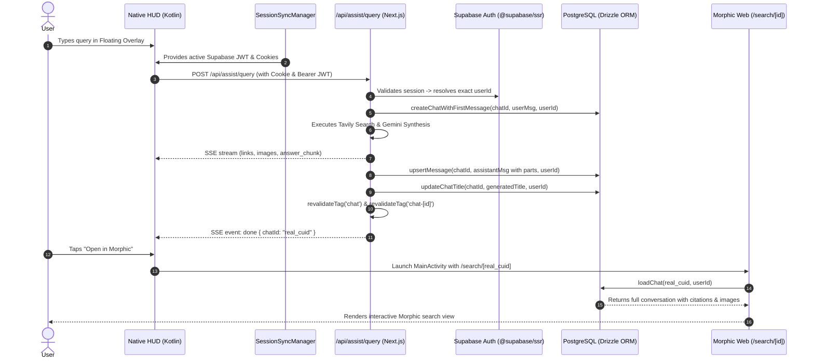

# Morphic Android Remodification Plan: Full Backend & Supabase Unification

## 1. Executive Summary & Root Cause Analysis

### The Problem
When evaluating the Android overlay on a physical device, the core architectural deficiencies were identified:
1. **Disconnected Execution ("Faking above Morphic")**: The overlay was calling a standalone endpoint (`/api/assist/query`) that bypassed Morphic's real agent pipeline and database persistence.
2. **Zero History / Sidebar Persistence**: None of the queries executed in the native overlay were saved to PostgreSQL (`chats`, `messages`, `parts` tables). Morphic's sidebar (`/api/chats`) remained blank.
3. **Broken Deep Linking**: Tapping "Open in Morphic" opened a generic homepage search (`?q=...`) or a dummy session ID (`sess_1791...`) that caused 404 Not Found in Morphic's search page (`/search/[id]`).
4. **Authentication Mismatch**: The native HTTP client was not properly resolving the user's Supabase session from the WebView because chunked cookies (`sb-*-auth-token.0`, `.1`) were not being assembled or decoded properly by `@supabase/ssr` on the server and native client.

---

## 2. Why We Must Unify Instead of Maintaining Separate Pipelines

| Aspect | Old Disconnected Approach | Unified Architecture (This Plan) |
| :--- | :--- | :--- |
| **User Identity** | Isolated device ID or failed regex cookie parsing | **Exact Supabase User**: Same `userId` from Supabase session cookies & Bearer JWT |
| **Database Storage** | Ephemeral, in-memory, zero DB rows | **PostgreSQL via Drizzle ORM**: Every query creates real rows in `chats`, `messages`, `parts` |
| **Sidebar History** | Never appears in web sidebar | **Instant Sidebar Sync**: `revalidateTag('chat')` makes overlay chats appear immediately |
| **Chat Continuity** | Cannot open or continue in web | **Full Seamless Hand-off**: `/search/[id]` loads the real chat with all citations and research |
| **Search & Agent** | Simplified prompt & raw LLM | **Authentic Morphic Pipeline**: Exact same model selection, Tavily search, citation parts, and title generator |

---

## 3. End-to-End Unified Architecture



---

## 4. Detailed Implementation Phases

### Phase 1: Robust Supabase Auth Unification (`lib/api/mobile-auth.ts`)
1. **Support Both Bearer Token and Native Cookie Header**:
   - If `Authorization: Bearer <jwt>` is provided, validate against `supabase.auth.getUser(token)`.
   - If `Cookie` header is provided, use `@supabase/ssr`'s `createServerClient` or Next.js `cookies()` to natively parse all cookie chunks without brittle regex.
   - Correctly reassemble chunked Supabase SSR cookies (`sb-<project-ref>-auth-token.0`, `.1`, etc.).
2. **Support Anonymous Mode (`ENABLE_AUTH=false`)**:
   - Accurately fallback to `getCurrentUserId()` so Docker/self-hosted environments continue to work seamlessly.

### Phase 2: Real PostgreSQL Chat & Message Persistence (`app/api/assist/query/route.ts`)
1. **Generate Real CUID Chat IDs**:
   - `const chatId = body.chatId || generateId()` using `@paralleldrive/cuid2`.
2. **Atomic Initial Chat Creation**:
   - On first turn (`!body.chatId`), call `createChatWithFirstMessage(chatId, userMessage, auth.userId, title)`.
   - Start `generateChatTitle` in parallel using Morphic's title generator agent.
3. **Multi-Turn Chat Appending**:
   - If `body.chatId` is passed, verify chat ownership and call `upsertMessage(chatId, userMessage, auth.userId)`.
4. **Structured Assistant Persistence with Citations**:
   - When LLM synthesis finishes, construct an authentic `UIMessage` containing:
     - `text` part (the synthesized markdown answer)
     - `source-url` parts for each search result (title, URL, domain)
   - Save via `upsertMessage(chatId, assistantMessage, auth.userId)`.
   - Update `chats.title` with the generated title.
   - Call `revalidateTag('chat')` and `revalidateTag(`chat-${chatId}`)`.
5. **SSE Done Event**:
   - Send `{ event: "done", data: { chatId, sessionId: chatId, durationMs, userId } }`.

### Phase 3: Android Session Synchronization (`SessionSyncManager.kt` & `MorphicApiClient.kt`)
1. **Full SSR Cookie Chunking Support**:
   - Update `SessionSyncManager.kt` to collect all `sb-*-auth-token.*` cookies, sort them by chunk index, concatenate base64 chunks, and decode the full session payload (`access_token`, `user.id`, `user.email`).
2. **Dynamic Header Injection**:
   - In `MorphicApiClient.kt`, always pull current cookies from `CookieManager.getInstance().getCookie(baseUrl)` and pass both `Authorization: Bearer <token>` and `Cookie: <cookies>` on every API call.
3. **WebView Auth State Listener**:
   - In `MorphicWebViewContainer.kt`, inject an auth listener into the WebView so logins/logouts in the web UI immediately synchronize native state.

### Phase 4: Overlay Deep Linking & Multi-Turn Support (`HudView.kt`)
1. **Track Active Chat ID**:
   - Store `currentChatId` in Compose state. When a query is initiated, assign a pre-generated ID or capture the `chatId` from the backend `done` event.
2. **Real "Open in Morphic" Navigation**:
   - Replace the generic `?q=...` URL with:
     ```kotlin
     data = Uri.parse("${BuildConfig.MORPHIC_BASE_URL}/search/$currentChatId")
     ```
3. **Multi-Turn Continuity**:
   - When the user asks a follow-up question in the same HUD session, pass `chatId = currentChatId` in `AssistQueryRequest` so messages append to the same thread in PostgreSQL.

### Phase 5: Verification & Quality Assurance
1. **Compilation & Type Checking**:
   - Backend: `bun typecheck` & `bun lint`.
   - Android: `./gradlew assembleDebug`.
2. **Device Testing**:
   - Install to physical device CPH2613 via ADB.
   - Perform search in overlay while authenticated.
   - Verify chat record exists in Supabase PostgreSQL (`chats` table).
   - Verify chat appears in Morphic web sidebar.
   - Tap "Open in Morphic" and verify the full conversation loads at `/search/[id]` with citations and interactive follow-up capability.
